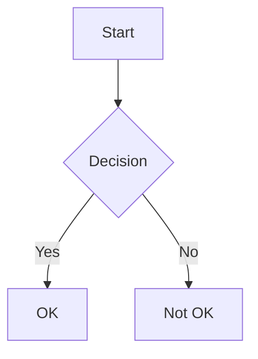

# Leed Markdown Content Reference

Content pages use Leed's extended Markdown format (markdown-it + ~30 custom plugins). HTML pass-through is enabled for markdown rendered from a template, but a **CMS page body** cannot hold HTML: raw HTML written into one is kept as literal text and shows on the page exactly as typed (an HTML comment is stripped, and `<br>` is a line break). Typographer is enabled for display only (see Smart Typography). Content is processed before Handlebars templating.

**Note:** Content `.md` files are managed by the CMS — you do not create them. This reference is for understanding the format when building layouts and templates that render content, and for any content written directly in `.hbs` templates using the `{{{ process content }}}` helper.

**Full spec:** The complete, authoritative Leed Markdown reference ships alongside this file as `leed-markdown-format.md` in this folder. This file is a condensed, styling-focused view — consult `leed-markdown-format.md` for the full syntax, and when the two disagree, the full reference wins.

---

## Attribute Syntax

All block and inline elements support extended attributes via `{...}` syntax.

**Block-level** (on own line or at end of line):
```markdown
# Heading {.my-class data-value="test"}

Paragraph text {data-id="p1"}
```

**Inline** (immediately after element, no space):
```markdown
[link text](https://example.com){data-id="123" target="_blank"}
{data-assetid="aaa123" data-id="zzz"}
```

**Shorthand:** `.classname` = class, `key="value"` = arbitrary attribute. Multiple classes: `{.class1 .class2 .class3}`

**`id` is not supported.** A `#id` shorthand (or `id="…"`), in any letter case, is read as attribute syntax and then dropped from every element — in a CMS page body and in markdown rendered from a template alike. The ids the renderer makes itself (heading slugs, tab and panel ids, checkbox ids) are unaffected.

---

## Headings (h1-h5 auto-anchored)

```markdown
# Main Heading       → <h1 id="main-heading">
## Sub Heading       → <h2 id="sub-heading">
###### Sixth Level   → <h6> (no anchor, h6 only)
```

### Heading anchors

Ids are generated at build time from the heading text by `@sindresorhus/slugify` (via
`markdown-it-anchor`), for levels 1–5 only. The slug does more than lower-case-and-hyphenate:

```
## Payment, tax and renewal    → id="payment-tax-and-renewal"
## Same Heading (2nd, 3rd)     → id="same-heading-1", "same-heading-2"
## Q&A: what's next?           → id="q-and-a-whats-next"      (& → and)
## fooBarBaz and HTTPServer    → id="foo-bar-baz-and-http-server"  (decamelized)
## Café Über Naïve             → id="cafe-ueber-naive"        (transliterated, ß → ss)
## 你好 世界                    → id=""                        (nothing transliterable)
```

Link to a heading on the same page with the generated slug as a bare fragment, and to one on
another page with `[label](pageid:<pageId>#section-slug)`:

```markdown
## Payment, tax and renewal

See [Payment, tax and renewal](#payment-tax-and-renewal) below.
See [the terms](pageid:39e9c3c7-4741-432b-a49e-e59314f6d05d#payment-tax-and-renewal).
```

A fragment is not validated at build time — one that matches no heading still resolves, and the
reader silently lands at the top of the page. A `######` heading gets no id and can never be a
target.

A heading's `id` is always its generated slug. A `{#custom-id}` is read, then dropped, in a template as well as in a CMS page body, so `## Payment, tax and renewal {#payment}` renders with `id="payment-tax-and-renewal"` and a link written to `#payment` points at nothing. In a page body a heading or paragraph keeps only `data-id`; the rest of a trailing `{...}` group is stripped on import.

### Inline marks inside a heading

Inline code is supported inside a heading, at every level, and round-trips unchanged:

```markdown
## `batch` is the shape
```

`code` is the only content mark a heading allows. **Bold, italic, highlight, strikethrough, subscript, superscript, keystroke and links are not supported inside a heading** — a heading must keep looking like a heading. The CMS enforces this on import, so the content `.md` files you render never carry those marks in a heading: a heading's inline content is plain text, an inline code span, or an inline node such as math. A link inside a heading keeps only its text — the destination is dropped — so a heading never renders an `<a>`.

An unsupported mark is stripped on import and the heading text is kept, so `## **bold** heading` is stored and exported as `## bold heading`. No heading is ever dropped because of a mark it carries.

---

## Inline Formatting

```markdown
**bold**             → <strong>
*italic*             → <em>
~~strikethrough~~    → <s>
==highlighted==      → <mark>
H~2~O               → H<sub>2</sub>O (subscript)
E=mc^2^             → E=mc<sup>2</sup> (superscript)
`inline code`        → <code>
[[Ctrl]] + [[C]]     → <kbd>Ctrl</kbd>+<kbd>C</kbd>
```

Most inline markers (`** * ~~ == [[]]`) require a space or punctuation on the outer edge. Superscript (`^`) and subscript (`~`) work without surrounding spaces.

### Smart Typography
```markdown
"Hello"  → “Hello” (curly quotes)
'Hello'  → ‘Hello’ (curly single quotes)
--       → – (en-dash)
---      → — (em-dash)
...      → … (ellipsis — exactly three dots)
(c) (r) (tm) → © ® ™ (either letter case)
+-       → ±
```

The swaps are for display only; the stored text is never changed. The typographer never drops a character the author wrote: `!!!!`, `????`, `,,`, `..` and `....` render as written, and `?...` renders as `?…`. Inside a tab panel it is off.

---

## Images

### Bare image
```markdown

```

### Image with size (=WIDTHxHEIGHT in alt)
```markdown


```

### Image with caption (title triggers `<figure>`)
```markdown

```
Captions support inline markdown: `"Caption with **bold** and *italic*"`

### Image with caption + attributes
```markdown
{data-assetid="aaa123" data-id="zzz"}
```

### Link-wrapped image
```markdown
[{data-id="img-0"}](https://example.com) {data-id="link-1"}
```

---

## Code Blocks

````markdown
```python {data-id="code1"}
a = [x for x in range(10)]
```
````

- `data-id` moves to `<pre>` (not `<code>`)
- Language class on `<code>`: `class="language-python"`
- Syntax highlighted via highlight.js

---

## Math

### Block math (code fence with `math` language)
````markdown
```math {data-id="equation-1"}
E = mc^2
```
````
Renders as: `<pre data-id="equation-1"><code class="math">E = mc^2</code></pre>`

### Inline math (double backticks with `math` prefix)
```markdown
The equation ``math E = mc^2`` is famous.
```
Renders as: `<code class="math">E = mc^2</code>`

**Do NOT use `$$` or `$` delimiters** — Leed uses code fence and double-backtick syntax for math.

---

## Diagrams (Mermaid)

````markdown

````
Renders as `<pre class="mermaid">` (no `<code>` wrapper).

---

## Blockquotes

```markdown
> Quote line 1
>
> Quote line 2
{data-id="bq1"}
```

---

## Alert Containers

Types: `note`, `tip`, `info`, `warning`, `danger`

```markdown
:::note {data-id="alert-1"}
This is a note.
:::

:::tip Custom Heading {data-id="tip-1"}
Tip content here.
:::
```

Renders as `<aside class="alert alert-note">` with heading icon and content div.

Any type name is accepted, in any letter case (`:::NOTE` is a note): an unknown type renders as `alert alert-<type>`, unstyled unless your CSS styles it, and only the five above carry an icon and theme colors. A `.class` in the header group is added to the `<aside>`.

Nested alerts use extra colons for the outer:
```markdown
::::tip {data-id="outer"}
Outer content
:::info
Inner content
:::
::::
```

---

## Collapsible (Details/Summary)

### Closed
```markdown
+++ Click to expand {data-id="closed-1"}
Hidden content
+++
```

### Open by default
```markdown
++> Open by default {data-id="open-1"}
Visible content
++>
```

Nesting: use more `+` characters (`++++`, `+++++`).

---

## Lists

### Unordered with attributes
```markdown
- First item {data-id="list-1"}
- Second item
```
Attributes on first item apply to the `<ul>`.

### Ordered with a start number
```markdown
5. First
6. Second
```
The start number is written natively, as the first item's number (`<ol start="5">`). A `{start="5"}` group on the first item, as older content wrote it, is still read.

### Task lists
```markdown
- [ ] Unchecked task
- [x] Completed task
```
The first item decides the list's type: when it is a task, every item is a task, and an item with no box is unchecked.

---

## Tables

### Basic with alignment
```markdown
| Left | Right | Center |
| :--- | ----: | :----: |
| data |  data |  data  |
{data-id="table1"}
```

Alignment belongs to the column: every cell takes the alignment the separator gives the column it starts in, rendered as `style="text-align:…"`. It survives a CMS save, written back as `:---------`, `---------:` or `:--------:`, and editors set it from the table menu (Align left, center and right).

### Cell-level attributes
```markdown
| h1               |   h2 |         h3         |
| :--------------- | ---: | :----------------: |
| c1               |   c2 |     c3 {.red}      |
| c1 {colspan="2"} |   c3 |
| data             | more | last {rowspan="2"} |
| data             | more |
```

- A cell keeps `colspan`, `rowspan` and a class, and all three survive a CMS save (a class is written back as `{class="red"}`). Any other key in a cell's group is dropped; in the CMS editor a cell's class does not style the editor itself, but the site renders it as a real `class`.
- A body row lists only the cells that start in it, each in the next column a `rowspan` from above leaves free. A cell written where no column is free (such as an empty filler under a rowspan, which older content wrote) is dropped.
- The header row is positional: a position a `colspan` covers holds an empty filler cell, which is dropped.
- A span is cut to fit the table and to at most 1000 columns and 65534 rows. A table is at most four columns wide for each cell it holds (and at most 1000 columns, or as wide as its widest row when that is more).
- A CMS page body holds at most 50,000 table cells in all; a larger write is refused.
- A table's own attributes go on a line after the table (`{class="k"}`); a CMS page body keeps only its `data-id`.

---

## Tabs

```markdown
===tabs-container {data-tabs-groupId="languages" data-id="tabs1"}

@tab python {class="lang-tab"}
Python content here

@tab typescript {class="lang-tab"}
TypeScript content here

===
```

- Tab titles support `{title="tooltip text"}` attribute
- Tabs can contain any content: code blocks, mermaid, math, images, etc.

---

## Embeds (``)

### YouTube
```markdown

```

### Cloudflare Video
```markdown

```

### Audio
```markdown

```

### iFrame

The URL is supplied with `src` (the only supported URL parameter — `path` is not supported). All other attributes are optional and are rendered onto the `<iframe>` only when present in the markdown — nothing is injected when an attribute is omitted.

| Attribute | Required | Description |
| --- | --- | --- |
| `src` | yes | URL of the page to embed. |
| `title` | no | Accessible name for the frame. |
| `width` / `height` | no | Dimensions in pixels. |
| `sandbox` | no | Space-separated permission tokens, e.g. `allow-scripts allow-same-origin`. |
| `loading` | no | `lazy` or `eager`. |
| `allowFullScreen` | no | `true` or `false`. |
| `referrerPolicy` | no | Referrer policy, e.g. `no-referrer`. |
| `data-id` | no | Stable block identifier (set automatically by the editor). |

Minimal:
```markdown

```

Full options:
```markdown

```

### Form
```markdown

```

### Icon
```markdown

Click  to go home.
```

---

## Handlebars Comments (stripped before processing)

```markdown
{{!-- Block comment --}}
{{! Single-line comment }}
{{!--
Multi-line
comment
--}}
```

Escaped `\{{!-- ... --}}` is preserved as literal text.

---

## Attribute Placement Summary

| Element | Syntax | Lands On |
|---------|--------|----------|
| Heading | `# Text {attrs}` | `<h1>` |
| Paragraph | `Text {attrs}` | `<p>` |
| Code fence | `` ```lang {attrs} `` | `<pre>` |
| Link | `[text](url){attrs}` | `<a>` |
| Image | `{attrs}` | `` |
| List | `- item {attrs}` (first) | `<ul>` or `<ol>` |
| Table | `{attrs}` (after table) | `<table>` |
| Table cell | `content {attrs}` | `<td>` or `<th>` (`colspan`, `rowspan`, class) |
| Blockquote | `{attrs}` (after quote) | `<blockquote>` |
| Alert | `:::type {attrs}` | `<aside>` |
| Collapsible | `+++ Title {attrs}` | `<details>` |
| Tabs | `===tabs-container {attrs}` | container `<div>` |
| Tab label | `@tab name {attrs}` | `<span>` inside tab |
| Mermaid | `` ```mermaid {attrs} `` | `<pre class="mermaid">` |

---

## Content Processing Pipeline

1. **Markdown** is parsed with all Leed plugins
2. **HTML** output is generated with syntax highlighting, responsive images, etc.
3. **Handlebars** processes the HTML (template expressions, partials, helpers)
4. **Autolinks** are applied (matching text to internal links with UTM tracking)
5. **Content partials** (`{{> partialName }}`) within content are resolved

Handlebars expressions can be mixed in Markdown content — they are processed after Markdown rendering.
